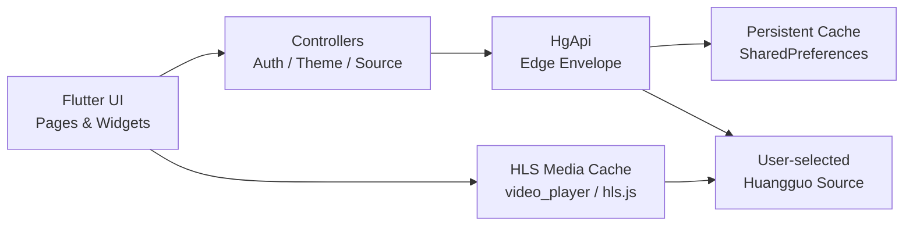

<p align="center">
  
</p>

<h1 align="center">果幕</h1>

<p align="center">
  <strong>黄果短剧第三方 Flutter 客户端</strong><br />
</p>

<p align="center">
  <a href="https://github.com/DearLicy/guomu/actions/workflows/build.yaml"></a>
  <a href="https://github.com/DearLicy/guomu/releases"></a>
  
  
  
  <a href="LICENSE"></a>
</p>

<p align="center">
  <a href="https://dearlicy.github.io/guomu/"><strong>在线预览</strong></a>
  ·
  <a href="https://github.com/DearLicy/guomu/releases"><strong>下载安装</strong></a>
  ·
  <a href="https://github.com/DearLicy/guomu/issues"><strong>问题反馈</strong></a>
</p>

---

## 关于果幕

果幕是一个面向黄果短剧场景深度优化的**第三方 Flutter 客户端**。项目重点不是把网页塞进 App，而是重新组织黄果短剧的内容发现、沉浸播放、本机续播、离线缓存和数据源切换，让浏览、切换与观看更接近原生应用体验。

界面、业务层、数据源管理和播放器均为本项目实现。所有内容均来自用户选择的第三方站点，果幕不提供、不存储、不分发任何音视频内容。

## 在线预览与下载

| 入口 | 地址 | 说明 |
| --- | --- | --- |
| Web 预览 | [dearlicy.github.io/guomu](https://dearlicy.github.io/guomu/) | GitHub Pages 只展示界面，不提供播放 |
| 最新版本 | [GitHub Releases](https://github.com/DearLicy/guomu/releases) | APK 与未签名 IPA |
| GitHub Actions | [Build Guomu](https://github.com/DearLicy/guomu/actions/workflows/build.yaml) | 自动校验、构建与发布 |

> iOS 安装包不包含签名，请使用 Sideloadly、AltStore、TrollStore 或自己的 Apple Developer 证书签名后安装。

## 为什么是果幕

黄果短剧客户端最核心的体验不是页面数量，而是“打开就能看，切集不中断”。

果幕围绕这个目标做了几件事：

- **沉浸播放**：上下滑切换、自动连播、邻近集预取、二倍速手势和清屏观看。
- **真正续播**：保存剧集、秒数和时长，从追剧、历史、详情、榜单或专题进入都能接上上次位置。
- **原生手感**：无网页式悬浮色块，无多余按钮，切换 Tab 保持状态，列表与播放页使用统一的轻量动效。
- **离线与弱网**：整部短剧缓存、HLS 分片下载、下载进度/网速、离线播放和失败回退。
- **追更与系统能力**：未完结短剧更新提醒、可选自动缓存、iOS 灵动岛与锁屏实时活动。
- **自主数据源**：支持多个黄果来源、官方发布页发现、GitHub 源清单和手动兜底，不依赖应用服务端。
- **隐私优先**：会话、追剧、历史、缓存和数据源均保存在本机；业务请求直接使用用户网络。

## 功能

### 内容发现

- 首页精选推荐、最近上新、热播短剧、专题推荐
- 更多推荐、全部上新、热播榜、全部专题
- 短剧 / 漫剧分类、题材标签、搜索与猜你喜欢
- 吃瓜资讯、黑料吃瓜、短剧剧评
- 热播榜、推荐榜、潜力榜

### 播放体验

- 竖屏沉浸播放、上下滑切集、自动连播
- 横屏播放与横竖屏状态同步
- 可拖动进度条、点击定位、拖动时间预览
- 长按临时二倍速、上滑锁定、下滑解除
- 邻近集播放地址预热与 HLS 媒体预取
- 整剧缓存、离线播放、下载进度与实时网速
- 退出、切集、切后台自动保存播放位置

### 账号与互动

- 黄果账号登录、注册和退出
- 昵称、签名、头像颜色编辑
- 点赞、收藏、追剧、评论与用户关注
- 本机观看历史、续播进度和内容页缓存
- 消息未读角标、关注与粉丝列表

### 应用体验

- 浅色 / 深色 / 跟随系统
- 可拖拽半屏面板、分享面板、显示模式选择
- 追更通知、自动缓存、后台检查开关
- iOS 灵动岛和锁屏实时活动
- GitHub Releases 在线更新检查
- Tab 页面预加载与微光骨架动画
- 多数据源管理、自动发现与故障回退
- Web、Android、iOS 多端构建

## 产品原则

1. **内容优先**：让封面、标题和播放路径成为视觉主线，而不是层层说明卡。
2. **动作就近**：播放、追剧、选集和互动放在用户需要它们的上下文中。
3. **状态连续**：页面切换不丢滚动，不重复请求，不同入口使用同一份本机进度。
4. **反馈克制**：使用触觉、短动效和就地状态，不用旧式弹窗和重复提示。
5. **网络可恢复**：优先缓存与预加载，失败时明确说明并提供手动数据源入口。
6. **不伪造数据**：内容、榜单、专题、用户和互动信息均来自真实接口；未知状态明确展示。

## 架构



业务请求通过站点边缘信封发送：

```text
POST /api/edge/request
```

播放地址按当前剧集获取：

```text
POST /api/videos/{id}/episodes/{ep}/playback
```

## 技术栈

| 层 | 技术 |
| --- | --- |
| UI | Flutter 3.35.1 / Material 3 / 响应式布局 |
| 状态管理 | Provider / ChangeNotifier |
| 网络 | Dio / 边缘代理信封 / 持久化缓存 |
| 播放 | video_player / HLS / 邻近集预取 |
| 存储 | SharedPreferences / Web Cache API / 原生缓存 |
| 安全 | AES-128-CBC 封面解密 / 本机会话存储 |
| 自动化 | GitHub Actions / GitHub Pages / GitHub Releases |

## 快速开始

环境要求：

- Flutter `3.35.1` stable
- Dart `3.9.x`
- iOS `15+`
- Android `24+`

```bash
git clone https://github.com/DearLicy/guomu.git
cd guomu
flutter pub get
flutter analyze
flutter test
flutter run
```

切换启动数据源：

```bash
flutter run --dart-define=HG_API_BASE=https://huangguoai.com
```

## 构建与发布

### GitHub 自动构建

每次推送 `main` 或手动运行 **Build Guomu**，流水线会执行：

- `flutter analyze` 与 `flutter test`
- Web Release 构建并部署 GitHub Pages
- Android Release APK 构建
- macOS runner 构建未签名 IPA
- 创建或更新对应版本 GitHub Release，并上传 APK 与 IPA

### 本地构建 Web

```bash
./tool/build_web.sh
```

### 本地构建 macOS IPA

必须在 macOS 上运行：

```bash
./build_ipa.sh
```

产物：

```text
build/ios/ipa/Guomu-<version>-unsigned.ipa
```

## 目录结构

```text
lib/
├── main.dart
└── hg/
    ├── api/       # 接口、缓存、数据源发现
    ├── auth/      # 会话、互动、主题与数据源状态
    ├── models/    # 内容、用户、评论、专题等模型
    ├── pages/     # 首页、剧场、吃瓜、榜单、我的、播放器
    ├── theme/     # 果幕视觉系统
    ├── utils/     # 播放历史、媒体缓存、格式化
    └── widgets/   # 通用卡片、骨架、分享与播放器组件
```

## 数据与隐私

- 客户端不需要部署业务服务端。
- 内容请求、账号请求和播放请求均从用户设备直接发往当前选择的数据源。
- 播放历史、追剧进度、主题、数据源和缓存保存在本机。
- 项目仓库不包含用户账号、Cookie、签名证书或私有密钥。
- Web 预览使用独立 CORS 中转以获得浏览器跨域能力；GitHub Pages 预览只展示界面，不加载视频，也不提供播放能力。原生安装包不依赖该中转。

## 路线图

- [x] 首页、剧场、吃瓜、榜单、我的五个主 Tab
- [x] 本地播放进度与跨入口续播
- [x] 可拖动进度条与二倍速手势
- [x] 多数据源自动发现
- [x] GitHub Pages、APK、IPA 自动化发布
- [x] 整部短剧离线缓存、下载队列与追更自动缓存
- [ ] 播放器画质、字幕与音轨选择
- [ ] 平板与横屏布局专项优化
- [ ] 可访问性与大字号适配

## 贡献

欢迎提交 Issue、功能建议和 Pull Request。

提交前请确保：

```bash
flutter analyze
flutter test
```

涉及界面的改动建议附带截图或短录屏，并说明修改前后的用户路径。涉及接口的改动请注明真实接口、请求形态和失败回退，不接受伪造数据。

## 免责声明

果幕不是黄果官方网站或官方客户端，与内容提供方不存在隶属关系。项目不提供、不存储、不分发任何音视频内容，所有内容、账号和互动数据均来自用户自行选择的第三方站点。

请在使用或分发前确认所在地法律法规、站点条款、内容版权和商标边界。因使用第三方内容或服务产生的责任由使用者自行承担。

## 开源协议

本项目基于 [GNU General Public License v3.0](LICENSE) 开源。

<p align="center">
  <sub>使用 Flutter 构建 · 由果幕开源社区维护</sub>
</p>
